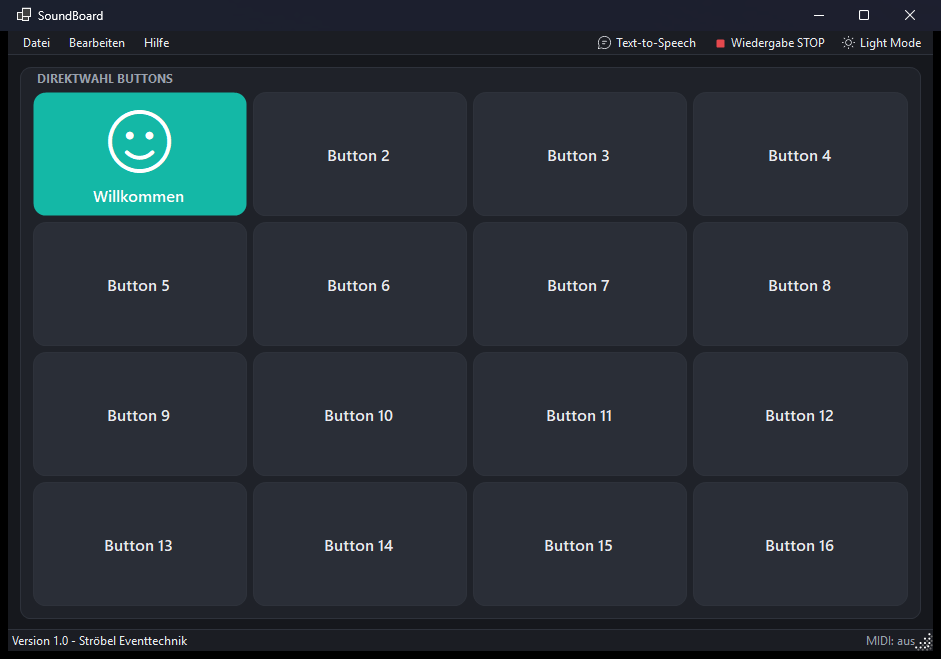
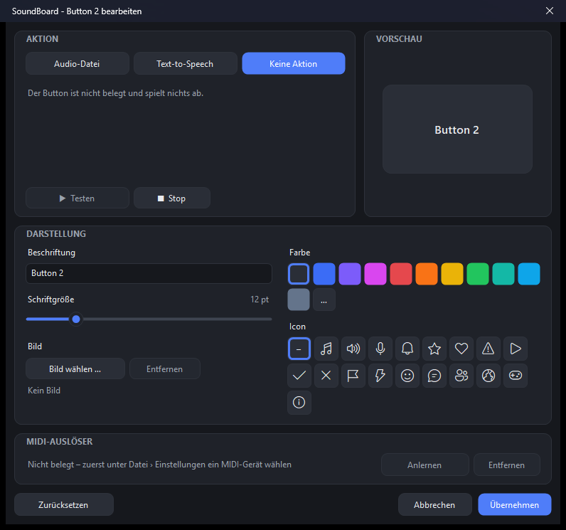
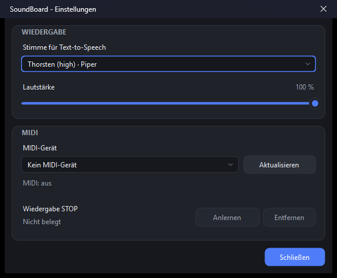
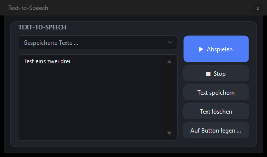

# 🎛️ SoundBoard

**Ein modernes Soundboard für Veranstaltungen – mit 16 frei belegbaren Buttons, natürlicher Offline-Sprachausgabe und MIDI-Steuerung.**

SoundBoard spielt per Klick oder per MIDI-Controller Audio-Dateien und gesprochene Texte ab. Die Oberfläche ist bewusst schlicht: Das Hauptfenster zeigt nur die 16 Buttons, alles andere liegt in eigenen Fenstern. Light und Dark Mode inklusive.



---

## ✨ Funktionen

- **16 Soundbuttons** in einem 4×4-Raster, das mit dem Fenster mitwächst – auch im Vollbild.
- **Audio-Dateien abspielen:** WAV, MP3, M4A, AAC, WMA, FLAC und AIFF.
- **Text-to-Speech, komplett offline**
  - mit den eingebauten Windows-Stimmen (z. B. Katja, Stefan, Hedda)
  - oder deutlich natürlicher mit [Piper](https://github.com/rhasspy/piper) und neuronalen Stimmen wie *Thorsten*
- **Texte speichern** und per Klick auf einen Button legen.
- **Buttons gestalten:** Beschriftung, Schriftgröße, Farbe, Icon oder eigenes Bild – mit Live-Vorschau.
- **MIDI-Steuerung:** USB-MIDI-Gerät wählen, Buttons und „Wiedergabe STOP“ per Anlernfunktion belegen.
- **Light / Dark Mode** inklusive dunkler Titelleiste.
- Ein laufender Sound wird am Button hervorgehoben; **Esc** stoppt jederzeit.

## 📸 Screenshots

| Button bearbeiten | Einstellungen |
|---|---|
|  |  |

| Text-to-Speech |
|---|
|  |

---

## 🚀 Erste Schritte

### Voraussetzungen

- Windows 10 (Version 2004 oder neuer) oder Windows 11
- [.NET 10 SDK](https://dotnet.microsoft.com/download) zum Bauen

### Bauen und starten

```powershell
git clone https://github.com/julianstroebel/SoundBoard.git
cd SoundBoard
dotnet run --project SoundBoard
```

Alternativ `SoundBoard.slnx` in Visual Studio öffnen und mit **F5** starten.

---

## 🧭 Bedienung

| Aktion | So geht's |
|---|---|
| Sound abspielen | Button anklicken oder per MIDI auslösen |
| Wiedergabe stoppen | **Esc**, „Wiedergabe STOP“ in der Menüleiste oder per MIDI |
| Button belegen / gestalten | **Strg+E** (Editierungsmodus), dann den Button anklicken |
| Text sprechen lassen | **Strg+T** öffnet das Text-to-Speech-Fenster |
| Einstellungen | **Strg+,** oder *Datei → Einstellungen …* |

### Button bearbeiten

Im Editierungsmodus (rosa bzw. dunkelroter Hintergrund) öffnet ein Klick auf einen Button dessen Einstellungen:

- **Aktion:** Audio-Datei, Text-to-Speech oder keine Aktion – mit „Testen“ direkt anhören
- **Darstellung:** Beschriftung, Schriftgröße, 10 Farben oder eigene Farbe, 18 Icons oder ein eigenes Bild
- **MIDI-Auslöser:** „Anlernen“ klicken und am Controller eine Taste, ein Pad oder einen Regler betätigen

### Text-to-Speech

Im Text-to-Speech-Fenster lässt sich ein Text eingeben und sofort abspielen. Mit **Text speichern** landet er unter einem Namen in der Auswahlliste, **Auf Button legen …** weist ihn einem der 16 Buttons zu. Das Fenster darf offen bleiben, während du mit den Buttons arbeitest.

---

## 🗣️ Natürliche Stimmen mit Piper (optional)

Ohne weitere Einrichtung nutzt SoundBoard die Windows-Stimmen. Für eine wesentlich natürlichere Aussprache kann [Piper](https://github.com/rhasspy/piper) eingebunden werden – ebenfalls komplett offline:

1. [`piper_windows_amd64.zip`](https://github.com/rhasspy/piper/releases/tag/2023.11.14-2) herunterladen und den Inhalt des Ordners `piper` nach `%AppData%\SoundBoard\piper\` entpacken.
2. Eine deutsche Stimme aus den [Piper-Voices](https://huggingface.co/rhasspy/piper-voices/tree/v1.0.0/de/de_DE) laden – jeweils die `.onnx`- **und** die `.onnx.json`-Datei – und in denselben Ordner legen. Empfehlung: `de_DE-thorsten-high`.
3. SoundBoard neu starten und unter *Einstellungen → Stimme* die Piper-Stimme wählen.

> 💡 Liegt Piper in `%AppData%\SoundBoard\piper\`, kopiert der Build den Ordner automatisch als `piper\` neben die `SoundBoard.exe`. Eine andere Quelle lässt sich mit `dotnet build -p:PiperSource=C:\pfad\zu\piper` angeben.

---

## 🎹 MIDI einrichten

1. USB-MIDI-Controller anschließen.
2. *Datei → Einstellungen → MIDI-Gerät* wählen (oder „Alle angeschlossenen Geräte“). Neu angesteckte Geräte erscheinen nach **Aktualisieren**.
3. **Wiedergabe STOP** direkt in den Einstellungen anlernen.
4. Für jeden Button im Editierungsmodus unter **MIDI-Auslöser** auf **Anlernen** klicken und am Controller auslösen.

Unterstützt werden **Note On**, **Control Change** und **Program Change** auf allen 16 Kanälen. Jeder MIDI-Befehl gehört immer zu genau einer Aktion – wird er neu vergeben, fragt SoundBoard nach und entfernt ihn an der alten Stelle.

---

## 💾 Wo werden Daten gespeichert?

| Was | Ort |
|---|---|
| Buttons, gespeicherte Texte, MIDI-Belegung | `%AppData%\SoundBoard\config.json` |
| Bilder der Buttons (Kopien) | `%AppData%\SoundBoard\images\` |
| Piper und Stimmen | `%AppData%\SoundBoard\piper\` |
| Theme, Stimme, Lautstärke, MIDI-Gerät | Benutzereinstellungen der App (`user.config`) |

Audio-Dateien werden nur verknüpft, nicht kopiert – sie sollten also an ihrem Ort bleiben.

---

## 🗂️ Projektstruktur

```
SoundBoard/
├── Audio/      Wiedergabe (NAudio) und Sprachausgabe (Windows-Stimmen, Piper)
├── Controls/   Eigene Steuerelemente: Buttons, Karten, Regler, Auswahllisten, Icons
├── Forms/      Hauptfenster, Button-Editor, Einstellungen, Text-to-Speech, Dialoge
├── Midi/       MIDI-Eingang und Anlernfunktion
├── Model/      Konfiguration (JSON)
└── Theming/    Light-/Dark-Theme und Menü-Renderer
```

## 🧩 Verwendete Komponenten

- [NAudio](https://github.com/naudio/NAudio) – Audio-Wiedergabe und MIDI
- Windows-Sprachausgabe (`Windows.Media.SpeechSynthesis`)
- [Piper](https://github.com/rhasspy/piper) und [Piper-Voices](https://huggingface.co/rhasspy/piper-voices) (optional) – neuronale Offline-Sprachausgabe

Es gelten die Lizenzen der jeweiligen Projekte.

---

<p align="center">Made with ❤️ by <b>Ströbel Eventtechnik</b></p>
